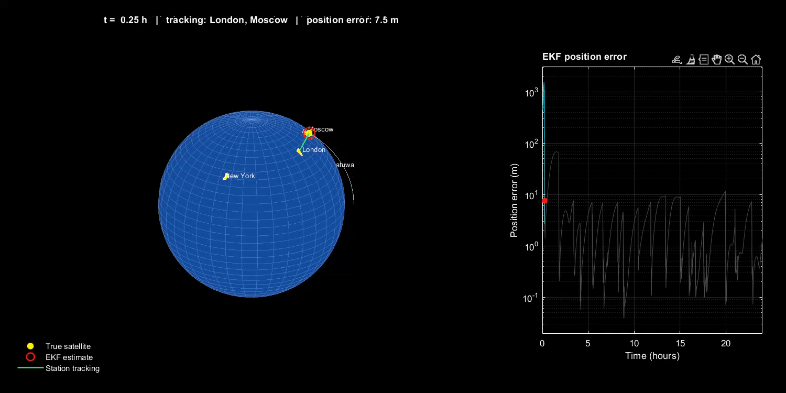
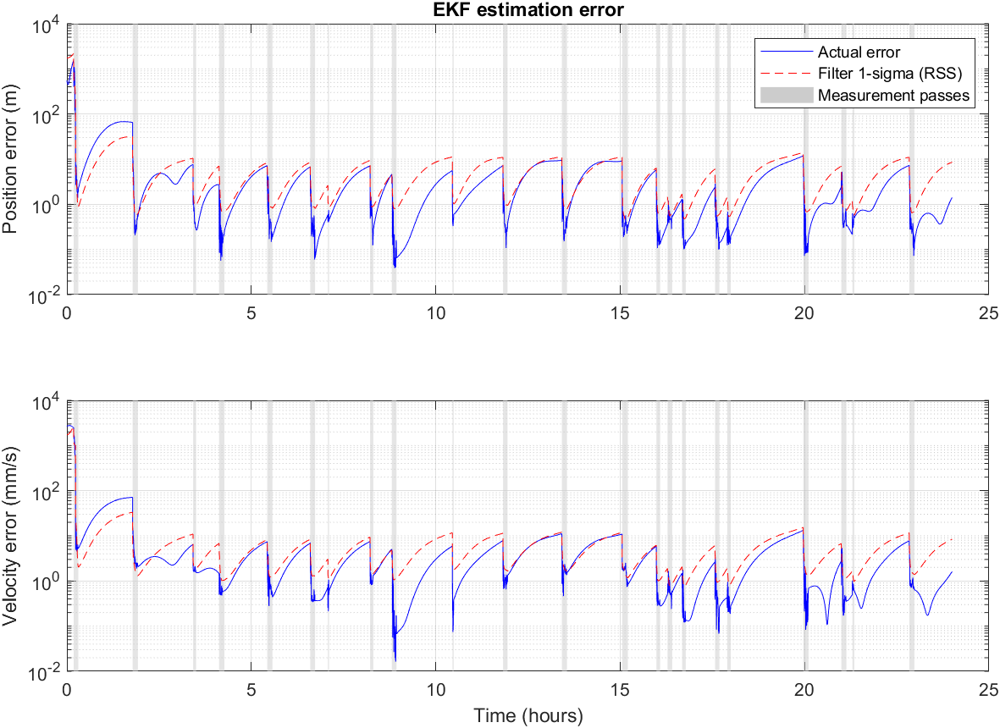

# Satellite Orbit Determination with an Extended Kalman Filter

EN4594 Autonomous Systems, University of Moratuwa. Mini project by Praveen V.V.J.

An Extended Kalman Filter (EKF) that tracks a low-Earth-orbit satellite from ground-station **range** and **range-rate** measurements. Everything is written in MATLAB and runs on simulated data.

## 3D animation

Click the picture to play the video (`results/orbit_animation.mp4`). It shows the rotating Earth, six ground stations, the true satellite (yellow), the EKF estimate (red ring), a green line of sight whenever a station is tracking, and the position error curve filling in on the right.

## What it does

- Simulates a 24-hour sun-synchronous orbit (two-body gravity + J2 + a small drag force the filter does not know about).
- Six ground stations (Moratuwa, London, New York, Tokyo, Sydney, Moscow) give noisy range (10 m) and range-rate (1 mm/s) readings whenever the satellite is above 10 degrees elevation.
- The EKF predicts the orbit with RK4, linearises with Jacobians (analytic measurement Jacobian, state-transition matrix from the variational equations) and corrects once per visible station.
- The filter is checked with NEES, NIS, normalised innovations and 3-sigma bounds.

## Main results (seed 1, default settings)

| Quantity | Value |
|---|---|
| RMS position error after 2 h | 4.03 m |
| RMS velocity error after 2 h | 4.25 mm/s |
| Time with measurements | 10.5 % of 24 h |
| Mean NIS (ideal 2) | 2.07 |
| Mean NEES (ideal 6) | 1.74 (slightly cautious filter) |
| Monte Carlo, 20 runs | 3.78 +- 0.33 m |

## How to run (MATLAB R2023a, no extra toolboxes needed)

1. Open this folder in MATLAB.
2. Run `run_orbit_ekf` to simulate, filter, print a summary and make the figures (saved in `results/`).
3. Run `run_experiments` for the parameter studies and the Monte Carlo test (about 3 minutes).
4. Run `run_animation` to play the 3D animation.
5. Run `check_report_numbers` to print every number quoted in the report.

All settings (orbit, stations, noise, filter tuning) are in `default_config.m`.

## Code guide

Read the EKF files in this order:

| File | Role |
|---|---|
| `default_config.m` | all settings |
| `run_simulation.m` | truth, measurements, EKF, error metrics |
| `run_ekf.m` | the filter loop (NEES and NIS are computed here) |
| `ekf_predict.m` | prediction step, `P = Phi*P*Phi' + Q` |
| `propagate_state.m` | RK4 propagation of the state and the state-transition matrix |
| `range_model.m` | measurement function and its Jacobian |
| `ekf_update.m` | correction step (Joseph form) |

The simulated world is in `simulate_truth.m`, `simulate_measurements.m`, `orbit_accel.m`, `kepler_to_state.m` and `station_eci.m`. Plotting and printing are in `plot_results.m` and `print_summary.m`; the animation is `animate_orbit.m`.

## Report

The full report (theory, derivations, implementation, results, discussion) is `report/report.pdf`; its LaTeX source is `report/report.tex`.

## Results folder

`results/` contains the figures used in the report and the animation video.
